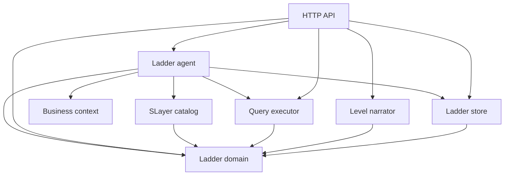
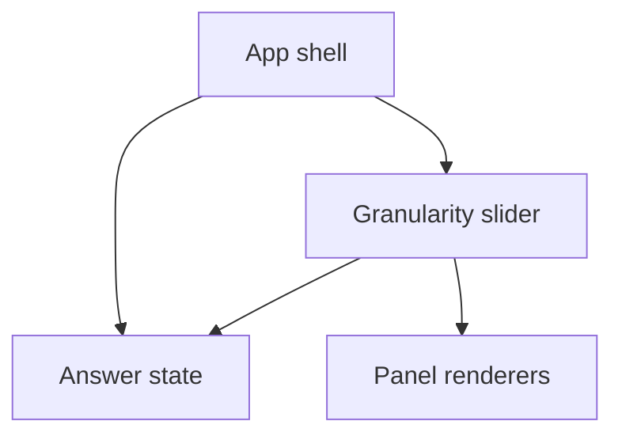

# System

## Purpose and context

slayer-zoom answers one data question at the granularity the reader chooses. A slider moves from a single number,
through splits, mix and segments, to trends and drivers. Each step is a SLayer query that refines the one before it,
so every number reconciles with the step before it. An agent builds the ladder of steps from the semantic layer and
the business context. SLayer and the Anthropic API are outside the system; the reader uses the web app.

## Building blocks

<!-- likec4:python -->

<!-- /likec4:python -->

<!-- likec4:typescript -->

<!-- /likec4:typescript -->

## Principles

1. Numbers reach the reader only from SLayer results. No component writes SQL, and no LLM output is shown as a number. [enforced: test:tests/test_agent_loop.py]
2. Moving the slider never calls an LLM or the database: every level is computed when the question is answered. [enforced: test:web/src/state/store.test.ts]
3. Every ladder can be re-rendered from its stored trace without an API key, and the checks in CI never need one. [enforced: test:tests/test_traces.py]
4. Every number in a narration appears in the result rows of its level. [enforced: test:tests/test_narrator.py]
5. Only the elements that own an integration import its client: SLayer in the catalog and the executor, Anthropic in the agent and, from #3, the narrator. [enforced: test:tests/test_import_law.py]
6. Web panels render a panel and its rows, and never compute numbers. [review] [lang: typescript]

## Rationale

The ladder is data (`python.core`), not prose, so the agent, the executor, the narrator and the web app share one
typed contract, and the invariants can be checked before anything reaches the reader. Keeping the LLM to planning
and wording, and SLayer to numbers, is what makes a zoomable answer trustworthy: a split that does not add up to its
parent, or a number the model made up, would break the reader's trust in every level. The agent therefore emits
only queries: the catalog shows it the semantic layer, the context tells it what the reader means, and each level it
submits is validated and run before the reader sees it. The narrator, the last element of the target structure in
`docs/plan.md`, joins the model in #3.
